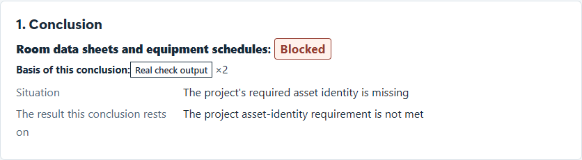

# BIM Doctor

**Understand a model check, find the next action, and see what changed.**

[中文](README.zh-CN.md) · [Watch the 80-second demo](docs/evidence/doctor-resume-ui-en-2026-10-13/doctor-live-en.webm) · [Product case study](https://app.notion.com/p/3be1cb002005801b8d5dd536615d46f9) · [Quick start](#quick-start)

A BIM coordinator preparing a model handover needs more than a list of failed
checks. Which piece of work is affected? What should someone do next? What
changed when the model was checked again?

BIM Doctor brings those answers together in a local browser application. It is
built for people coordinating building models across teams. IFC is the open file
format used to exchange those models.

## 3D model review and optional AI advice

Open **[the 3D workspace](http://127.0.0.1:8765/review.html?lang=en)** after starting
the local server below. Load the public three-model example or import one IFC
file, select a check result and focus or isolate its actual geometry. Four review
checks cover air-terminal type, readable names, storey association and model-local
GlobalId integrity. Information prompts remain separate from check failures.

Each result includes observed evidence, practical local guidance and verification
steps. Optional OpenAI advice uses the selected finding's text evidence; IFC files
and mesh data stay in the local server. Set `OPENAI_API_KEY` in the server's
environment to enable it. [Setup and current limits](doctor/README.md#3d-review-workspace).

## A check with somewhere to go next

In the bundled example, a duct segment is missing the asset identifiers needed
for the project's equipment schedule. Doctor connects that finding to the work
it affects, then shows the proposed action and what a later check should establish.



The page follows **conclusion → next step → details**. Element identifiers and
individual check results remain available when the reader needs to investigate.

The supplied recheck adds a useful twist: the model stays the same, but a check
requirement changes and this item's conclusion moves from Blocked to Ready.
Doctor shows that reason beside the change. It gives the reader a way to
understand a different answer without assuming the model was repaired.

**[Watch the full example](docs/evidence/doctor-resume-ui-en-2026-10-13/doctor-live-en.webm)** — an 80-second silent recording of the English interface.

## Explore an example or check a file

- **Explore a simulated handover.** Follow an item from its first conclusion to
  its next action and supplied recheck. Public models and example project
  decisions make the workflow available without preparing your own files.
- **Check your own IFC4 file.** Run a real check of how air terminals declare
  their type. The current rule accepts `DIFFUSER`, `GRILLE`, `LOUVRE`, or
  `REGISTER`; results show the object and its identifier for finding it in the
  source model. Files and check records stay on your computer.

These paths answer different questions. The example explains a handover decision;
the own-file check evaluates one declared property. Keeping them separate avoids
applying the example project's conventions to someone else's model.

## Quick start

You need **Python 3.11+**, **Git**, and a browser. Setup below was tested on
Windows PowerShell; the first install downloads about 80 MB.

```powershell
git clone -c core.longpaths=true https://github.com/EricRoosevelt/epc-digital-delivery-control-tower.git
cd epc-digital-delivery-control-tower
py -m venv .venv
.\.venv\Scripts\python.exe -m pip install -r requirements.txt
.\.venv\Scripts\python.exe doctor/serve.py
```

Open **[BIM Doctor in English](http://127.0.0.1:8765/?lang=en)** and choose
**Choose a simulated example**. Stop the server with **Ctrl+C**.

[Step-by-step guide and sample files](docs/quick-start.md) · [中文快速开始](README.zh-CN.md#快速开始)

## Current scope

This personal open-source application demonstrates simulated handovers and runs
one real rule on local IFC4 files. Handover decisions depend on the stated project
requirements; the local check reports that rule's result, not an overall quality
score. Model editing, work assignment, browser-initiated rechecks, and a 3D viewer
are future work. The main flows are bilingual; some secondary record pages remain
Chinese-only.

## Build on it

The application uses Python and IfcOpenShell to read models, with a plain
HTML/CSS/JavaScript interface. The underlying framework supports configurable
checks and exports, including issue files other BIM tools can read (BCF).

- [Engineering reference](docs/engineering-reference.md): architecture and development commands.
- [Rule definitions](rules/product-validation/README.md) and [data formats](docs/data_contract.md).
- [Automated checks](https://github.com/EricRoosevelt/epc-digital-delivery-control-tower/actions/workflows/ci.yml).
- [Earlier Power BI / Speckle work](dashboard/README.md): the reporting stage of the same project.
- [Detailed technical reference from the previous README](https://github.com/EricRoosevelt/epc-digital-delivery-control-tower/blob/3145c61c89037cec3d9825b5f2dbee6587307d1d/README.md#reference).

## Data Source and Attribution

The IFC sample models are taken from the buildingSMART International
[Sample-Test-Files repository](https://github.com/buildingSMART/Sample-Test-Files),
specifically the
[IFC 4 PCERT Sample Scene](https://github.com/buildingSMART/Sample-Test-Files/tree/main/IFC%204.0.2.1%20%28IFC%204%29/PCERT-Sample-Scene).

Files used:

* `Building-Architecture.ifc`
* `Building-Structural.ifc`
* `Building-Hvac.ifc`

A second project uses three further unmodified samples from the same
repository, the
[IFC 4 ISO Spec Reference View 1.2 set](https://github.com/buildingSMART/Sample-Test-Files/tree/cecf656112a54a0d8cdd8b06b9398bfea5163886/IFC%204.0.2.1%20%28IFC%204%29/ISO%20Spec%20-%20ReferenceView_V1.2),
pinned at commit `cecf656112a54a0d8cdd8b06b9398bfea5163886`:

* `wall-with-opening-and-window.ifc`
* `column-straight-rectangle-tessellation.ifc`
* `basin-tessellation.ifc`

Copyright buildingSMART International Ltd.

The sample files are licensed under the
[Creative Commons Attribution 4.0 International License](https://creativecommons.org/licenses/by/4.0/).

The IDS rules and normalization logic are authored for this portfolio
prototype and are not official buildingSMART delivery requirements.
