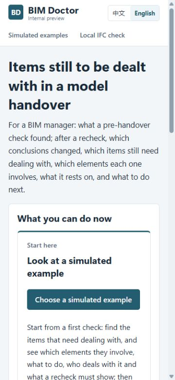
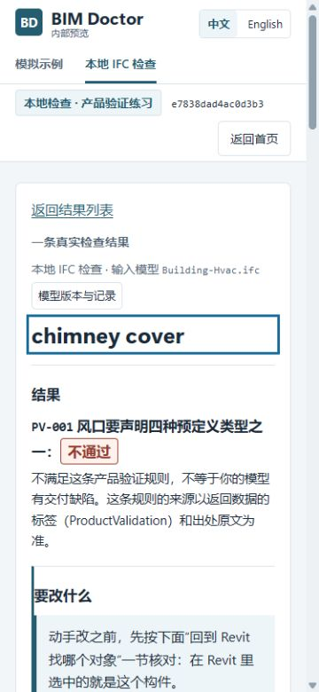
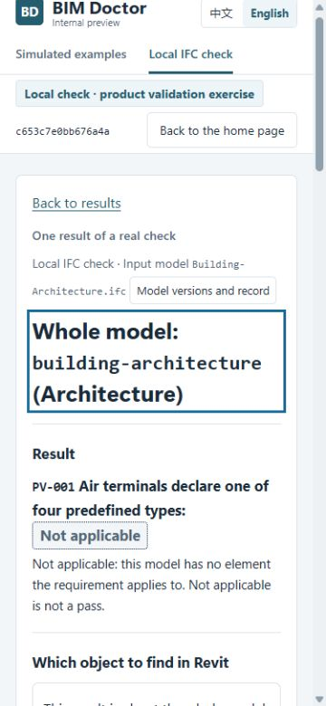

# PR #64：正式产品独立 UX 验收

2026-10-13（新加坡）。Head `de6940eb3c65b6e7a7af8872ffd37cc98018551a`；base `c62df8cc0c1d930e95827186709df3ef4a509e03`。

**判定：PASS（本轮已批准范围的独立实页验收），发现真实阻塞0。** 首页、两条主路径、语言/对象/查询连续性、定位后换对象、选中行返回、搜索0/1/2和主路径视觉一致性均有本轮正式应用证据。没有追加风格或普通润色，也没有要求新一轮设计。以下覆盖边界保留，不把PASS扩大为完整平台/异常环境证明、真人首访、C2、冻结或素材完成。

## 对象与执行

已完整读最新[实施交接](2026-10-12-ui-implementation.md)的当前段与附后正式报告、PM implementation-decision及生产验收矩阵。此前准备矩阵与预览评审保留原样；本轮没有重验v1/v2预览或引用实现者截图作通过证据。

将指定head用Git tar导出到本会话独立目录，用项目已有`.venv`实际启动候选`doctor/serve.py`，仅监听`127.0.0.1:18885`，checks独立于snapshot及共享checkout。浏览器实际走正式adapter示例；本地通过页面选文件、声明专业、确认范围和运行，未注入假API或复制预览快照。不是新clone/new venv安装验收。

Base是head祖先。服务器实际提供的doctor.css/app.js/screens.js/workspace-screens.js四个资源逐字节匹配head，独立快照另核全部Doctor源码。共享根目录仍在旧分支/HEAD，未切换、重置、清理、暂存或修改产品/依赖。head对base的rules、purpose-packs、epc_control_tower、data/processed、reports无diff；工程门禁、CI、集成和合并由TD独立负责，本轮不冒认实现者通过摘要为亲测门禁。

## 核心四组矩阵

桌面CSS视口1280×900、手机375×812；中英文都实际打开。四组本地搜索使用本轮新运行的同一次公开HVAC检查，不冒称四次独立模型检查。

| 检查 | 中文桌面 | 英文桌面 | 中文375 | 英文375 |
|---|---|---|---|---|
| 首页推荐主按钮完整首屏、先于长说明 | PASS | PASS | PASS | PASS |
| 示例目录→首检→独立单项、同项复检 | PASS | PASS | PASS | PASS |
| 单项/复检切语言保持对象与route | PASS | PASS | PASS | PASS |
| 本地搜索零/单/清空 | 0/1/2行 | 0/1/2行 | 0/1/2行 | 0/1/2行 |
| 实际选择、详情、输入身份、状态 | PASS | PASS | PASS | PASS |
| 定位后换对象，新标题与结论可见 | PASS | PASS | PASS | PASS |
| 查询/对象跨语言、返回选中行与焦点 | PASS | PASS | PASS | PASS |
| 文档滚动、无内部垂直双滚动/横向整页溢出 | PASS | PASS | PASS | PASS |

首页实测scrollY=0、body字号16px：375中文主按钮top494.88/bottom539.27，英文top617.78/bottom662.17；1280中文bottom416.45，英文bottom444.16。按钮和长说明的顺序由实际画面确认，未用顶部导航代替，也未把全页图当首屏证明。

## 逐路径结果与操作成本

1. **首页和目录：PASS。** 产品身份、真实导航、语言、内部预览成熟度标识一致；入口到真实示例目录或本地输入。中文/英文目录同一示例记录可打开，没有把设计预览“布局演示、不运行检查”的承诺装入应用。
2. **示例首检：PASS。** 13项/8需处理仍是4受阻、4无法判断、5无后续动作；“事项数不是缺陷数”在摘要旁。手机列表可滚动，摘要内定位入口一次激活即聚焦可见结果标题，不要求第一行固定y。没有新增示例搜索。
3. **独立单项和深链接：PASS。** building element按既有`item/2/2/2`独立route打开；另用新页面直接打开同一深链接成功。中文→英文及英文→中文均保留记录、对象和工作。一次返回定位相应行及其可见链接焦点；无动作READY事项返回时折叠自动打开，焦点不落在隐藏内容。
4. **同项复检：PASS。** 正式`recheck/of/schedules-and-room-data-sheets/2/2`四组实页保留BLOCKED→READY、两侧模型未重发、模拟检查依据、要求变化与“结论改变不等于原条件满足”。原全评估范围结束条件仍在第四节，与本项状态分开；没有把变化归因模型修复。本轮用这一实际代表路径核#58/#60边界，未全跑其他复检场景。
5. **本地输入→范围→运行：PASS。** 实际英文桌面单文件和英文375多文件输入均走选择、专业、范围、运行；不是四组各重上传。空输入请求范围时明确no-model、未运行/无结果，纠正后成功。实际异步示例请求期间观察到“读取检查记录”状态；未人为延迟API。
6. **搜索与详情：PASS。** `ux-no-match`零行、`house`一行、明确清空按钮恢复两行；隐藏行display none、高度0。Tab经过清空控件后到可见house链接，Enter能开正确详情。完整Tag/GlobalId另在英文375精确命中一行。桌面筛选外保留的旧详情有明确说明，不作为一条结果行。
7. **F-01/F-02对应正式场景：PASS。** 同一检查中`house`查询与house详情切语言后保留，URL没有查询文本。定位按钮只移焦点/文档，不改router hash。随后选择chimney，标题top约441px（桌面）、375px（手机），标题、结论及焦点可见，不停在旧定位区。手机按真实路径先返回列表再换对象，未强加两栏操作。
8. **页面返回和浏览器Back：PASS。** 手机单匹配→详情→页面返回，及再次打开→浏览器Back，均回到house可见选中行、查询仍为house，焦点在该链接；中英各实际执行。不检查精确scrollY，不要求跨刷新/永久保存。桌面返回及示例返回也检查选中目标；没有为通过而新增持久化要求。

目录、首检、单项、复检、本地输入/范围/结果/详情、拒绝和未知结果错误均继承同一应用壳、控件与视觉。桌面名称优先、状态横向，手机独立单列；本轮测到的页面没有内部垂直滚动容器或整页横向溢出。长内容仍可自然滚动；不是对所有断点作全量合规保证。

## 真实运行状态与来源

| 输入与本轮记录 | 实际结果 | 独立观察 |
|---|---|---|
| 随附Building-Hvac.ifc；`e7838dad4ac0d3b3` | 2 FAIL | 对象、Tag/GlobalId、动作/修改前核对、规则限定和空观察值可读；不是交付缺陷或ready判断 |
| 随附HVAC+Architecture；`c653c7e0bb676a4a` | 2 FAIL + 1模型级N/A | 范围含两个声明；N/A详情实际输入是Architecture，不借用首模型。明确不是通过、没有具体构件可找；本轮N/A在多文件运行中取得，没有另跑单独Architecture |
| 明确合成`SYNTHETIC-ux-pass.ifc`；`b3c5694280709e98` | 2 PASS | 用head自带生成器在checkout外生成并实际选择/运行；长名称/Tag保留，四组看详情；PASS说明证明/不证明什么，不补造观察值，也没有套FAIL修改任务 |
| 同一真实check下不存在的finding route | 明确错误 | 375英文显示“此检查无该结果”并聚焦可见错误；返回列表可恢复，没有把未知结果当成功、聚焦隐藏列表 |

合成输入只用于PASS和长字段验证，是buildingSMART公开HVAC样例的外部派生fixture，原文件未改；SHA-256 `5973b20668b6d4045fabeaea5afa98cfb2425008418cefe5477732193b3eaad9`。它不是未修改公开模型、Revit修复或真实项目成果，所有名称/Tag及文件名带SYNTHETIC。

手机详情实际显示本地模式及当前finding对应输入文件，不固定标“公开样例”。上传API没有可信样例来源字段，本轮接受如实文件身份，不要求按文件名猜来源。合成输入显示自己的文件名。模型版本按钮实际打开运行记录：例如HVAC内容摘要`11a8552b…03fa2b3`与输入一致，逻辑日期来自配置；不是软件head SHA。示例追溯也有原record的producing/consuming内容标识和记录入口。

已读取[同head BIM增量复核](2026-10-13-pr64-bim-review.md)：PASS、阻塞0、新增含义错误0。领域终审仍属BIM；本报告没有将其证据当作自身浏览器复验。新移动/折叠在正式页有实际入口，原要求/观察可展开，FAIL行动旁修改前核对、类型影响、源映射未知、未决定值/操作者仍可读。

## 证据、未覆盖边界与收尾

本轮68张接受JPEG及同状态DOM，18张关键图随报告保存，[清单](../evidence/2026-10-13-pr64-ux/screenshot-manifest.json)含完整SHA及尺寸。其余与观察JSON在本会话独立`review-pr64-2026-10-13/`证据包，不混用实现者105张PNG或旧预览图。原图没有缩放、重绘、拼接；视口变动期间两张不符合指定视口的诊断帧及一个截取不完整重拍帧明确排除，后续按指定视口重新观察/截取。含本机目录的输入/记录诊断图只留本机，不作公开素材。附图没有私有案例标识或本机敏感路径。

明确未覆盖：服务器500/断网/人为延迟恢复、缺失名称/文件名/Tag/楼层/未知规则的控制envelope、全部复检/全部13项详情、所有断点、完整缩放/屏幕阅读器/真实IME与软键盘、实体手机、超大模型/3D、Revit修改、真人首访及私有C2。空观察值和N/A的缺类别/楼层分支已经实际看见，但不扩大为上述所有缺字段覆盖。没有跑工程师外部Playwright脚本或复跑完整pytest/CI；不把实现者controlled注入记为本轮亲测。

本轮`node --check app.js`通过；对候选doctor/static的premium strict只读审计0 findings；浏览器console无error/warn。这些辅助检查不代替实页。仅要求已批准范围的真实阻塞；本轮没有发现应当修正后再验的阻塞，普通润色不重开。

版权buildingSMART International Ltd.；公开来源Sample-Test-Files，CC BY 4.0，原来源记录及合成生成器归属保留。没有公司/客户采用或实际交付验证声明。

PM可将本PASS与同head TD/BIM证据汇总，继续既定合并、集成及冻结基线核对流程；本会话不合并、发消息、冻结或制作素材。若head变化，只重核受影响部分，不把此PASS自动搬到新SHA。README新版截图/实际视频仍是后续独立交付，不能由本次代码/UI验收冒称完成。

收尾核验通过：21个Doctor源码文件匹配指定head；4组首页边界与字号、12个搜索状态的计数/隐藏行行为符合实测；68张接受截图及18张附图副本的哈希、全部报告链接均有效。实际JPEG为桌面1265×889、手机360×780；两个此前报告哈希未变，根目录生成路径diff/porcelain为空。独立服务器和本轮浏览器页已关闭。
